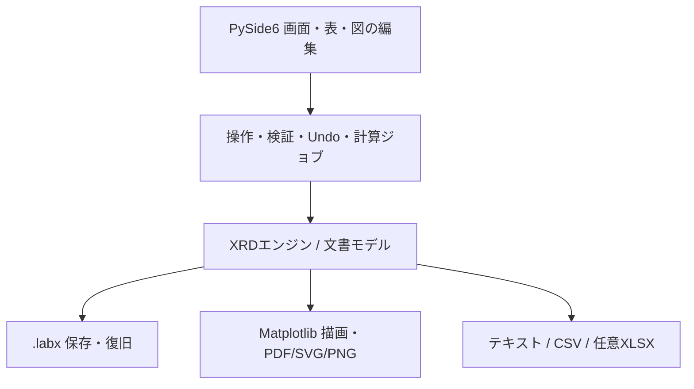

# XRD単体ソフト設計書 v1.0.0

2026-10-29 JST | 設計段階 | XRD専用

基準: Igor XRD Workbench v1.2.3 / `codex/xrd-v1.2.3` / `fb0c031093659db9db2562753dd0a0bd34561e4e`。本体45 IPF・604関数・14,632行を静的調査。機能一覧は52項目に整理。

ユーザー確定事項: 今回はXRDだけ。Igorなしで動く最終的な単一ソフトを設計。Excel利用は可能。M-H/M-T統合は今回の要件から撤回。

## 01. 設計の結論

### XRD専用の単一アプリ

XRD Studio（仮称）をWindows向けの独立デスクトップアプリとする。測定読込からピーク登録、参照比較、同定、局所フィット、格子定数、作図、保存・再開までアプリ内で完結させる。今回はXRDだけを対象にする。

### Excelの位置づけ

Excelは任意の表入出力先とする。解析計算、画面、保存の本体には使わない。Excel未導入のPCでも同じ解析ができるようにする。初期段階からこの境界を守り、後の再設計を避ける。

### 単一ソフトとしての配布

初期の正式配布は1個のインストーラーと1個の起動アプリ。内部ライブラリは同梱し、Igor・Python・Excelの別途インストールを要求しない。ポータブル単一EXEは別の配布形式として評価する。単一EXE内部での一時展開まで禁止する要件とは解釈しない。

### 移植の基準

基準はXRD Workbench v1.2.3。既存のXRD Studio v0.1.0は再利用候補であり、完成仕様の代わりにはしない。今回の成果は設計書で、本体の実装・科学計算試験は行っていない。

### 対象外と前提

過去の会話で不要とされた.pxp直接読込は今回も必須にしない。現行にないRietveld解析・定量相分率・CIFからの計算・装置固有RAW形式は初版の必須機能に追加しない。初版は現行機能の独立化を完了させる。

## 02. 現行機能から見た移植範囲

### 管理とデータ

複数プロジェクト、番号・表示名・組成、試料順、改名、削除・復元、他プロジェクトからの同定済み試料複製を維持する。原測定と規格化値を分離し、番号015の先頭0を保持する。

### ピークと参照

3つの検出経路、手動追加・削除、外部ピークリスト、再検出での保護、共通参照ライブラリ、版と重複検査、type別使用カード、元素適合、分類・候補除外、hkl不明の運用を対象にする。

### 同定と計算

候補モード、スコア内訳、共通シフト、証拠表、重なり、Unknown、主/第2反射確認、確認一覧、完了判定、局所フィット、立方晶/六方晶格子定数、履歴を引き継ぐ。

### 比較・作図・再開

プロジェクト横断比較、複数保存図、図の並び・線・マーカー・軸・文字・注釈・多列凡例、凡例のみの出力、Undo/Redo、復旧、自動保存をアプリ側で実装する。

### 機能の有無と動作保証を分ける

付録の機能一覧はコード上の実装経路を根拠にした調査。全操作の今回の動作保証ではない。元版の同梱テスト結果を独立版の合格に数えない。

## 03. 画面設計と操作の流れ

### 上部と左側

上部は「開く・保存・元に戻す・やり直す・出力」。左側はプロジェクト/試料ツリーと未確認・同定完了・要再計算の状態。編集対象は常に1試料とし、比較用チェックとは独立させる。

### 中央の解析領域

「測定ピーク → 参照候補 → ピーク同定 → 格子定数」の4段階を維持する。作図は独立タブにまとめる。中央上はグラフ、下はピーク/候補/証拠/履歴の表とする。

### 右側の条件

その段階で使う条件だけを表示し、基本/詳細を折りたたむ。同定では「候補を採用」「重なりとして追加」「Unknownにする」「同定を解除」を明示する。既存のダブルクリック採用も設定で利用可能にする。

### 寸法と選択の安定

主画面は作り直さず部品を再利用する。補助設定の開閉、表の更新、試料切替では主画面のサイズ・最大化状態を変えない。狭幅では右側条件をタブへ移す。図の明示的なサイズ変更だけはユーザー操作として扱う。

### 誤操作を避ける

通常クリックは登録ピークの選択だけ。追加は「ピークを追加」モードと角度確認を経由する。空白に吸着しない。比較試料0件は空表示。表示操作で同定やRawを変更しない。

```text
XRD Studio   開く / 保存 / Undo / Redo / 図・表を出力
┌────────────┬─────────────────────────┬──────────────┐
│ プロジェクト │ 測定ピーク / 参照候補 / 同定 / 格子 │ この段階の条件 │
│   015 試料A │                         │ 基本 / 詳細   │
│   016 試料B │ 測定曲線・相記号・参照棒         │ 候補を採用    │
│ 比較の選択  │                         │ 重なり / Unknown│
│ 保存した図  ├─────────────────────────┤              │
│ ごみ箱     │ ピーク / 候補 / 証拠 / 履歴の表    │              │
└────────────┴─────────────────────────┴──────────────┘
  編集中: 015 / 試料A   同定 12/15   未保存
```

## 04. 実装構成と技術の選択

### 推奨構成

Python + PySide6/Qt Widgets、NumPy/SciPy、Matplotlibを第一候補とする。Qtは一覧・分割パネル・ダイアログを担当し、Matplotlibは画面と印刷用描画を共有する。採用理由は既存の独立エンジンを生かしつつ、図と表の編集を作り込めるため。

### UIと計算の分離

UI → アプリケーション操作 → XRDエンジン/文書モデル → 保存・描画・入出力の依存方向とする。UIから配列を直接書き換えない。全変更は検証付きCommandを通し、Undoと更新対象を決める。

### 画面応答と計算

検出、参照候補計算、フィット、書出しはworkerへ渡す。jobは入力revisionを固定し、終了時に対象が変わっていたら古い計算を反映しない。参照角度の索引とrevision別の照合キャッシュで対象を絞る。表示用の間引きと解析用の全点配列を区別する。

### 配布

開発時は依存版を固定。配布はPyInstaller等でPythonと必要ライブラリを同梱する。初期はフォルダ同梱方式をインストーラーで包み、クリーンPC検証を先に通す。Qtプラグイン、日本語フォント、PDF/SVGバックエンドとライセンス文書の同梱を確認する。

### 技術選定の確定条件

PySide6画面で主画面サイズ保持、10万点の操作、文字倍率、論文用図の編集/出力を小さな試作で確認してから固定する。現行Tk UIは業務動作の参照とし、画面をそのまま全面移植する方針にはしない。



## 05. 保存形式とデータモデル

### 1つの解析文書

拡張子は既存試作の.labxを継続候補とし、ZIP + JSON + NumPy配列を基本にする。アプリ版とschemaVersionを分ける。既存schema=1をそのまま上書きせず、必要な変更時にschemaを上げて別名保存で移行する。

### 文書に含めるもの

projects、samples、raw/processed配列、peak、assignment、referenceRevision、profileRun、latticeRun、plotRecipeと数値snapshot、style、操作履歴を保存する。表示状態は同じ文書内の別領域とし、科学的revisionには含めない。

### 識別子

projectID/sampleID/peakID/referenceID/revisionID/reflectionID/plotIDを固定する。表示名・フォルダパス・表の行番号を主キーにしない。参照版は不変で、編集は新しい版として追加する。

### 共通参照の範囲

現在の「Experiment共通」は新ソフトでは「解析文書共通」に対応させる。PC上の再利用ライブラリを別に持ち、使用した参照の内容と版は文書内にも埋め込む。元フォルダを移動しても解析を再開でき、ライブラリ更新で既存同定を変えない。

### 原子的保存と復旧

同じ保存先の一時ファイルへ書込 → 構造と配列ハッシュ検査 → flush/置換で通常保存する。5分/3世代を初期案とする復旧保存は別の場所へ行い、通常保存の未保存表示を解除しない。起動時に復旧候補を示す。

### 削除と履歴

削除は文書内ごみ箱へ。Rawと解析の対応、保存図snapshot、共通参照を保つ。管理操作はtransactionで一括成功/復元。解析Undo、表示の戻る、管理バックアップの役割を分ける。

## 06. ピーク検出と同定の科学的仕様

### 規格化

表示強度は100*(I-min(I))/(max(I)-min(I))。定数信号は0。原角度・原強度は不変。検出用の再標本化や平滑化の配列は独立して保持し、登録角度の由来を記録する。

### 検出方式

旧しきい値方式と現行Robust方式は移植・比較する。Igor Peak AutoFindは外部依存なので独立方式を実装し、別のアルゴリズム名を付ける。既存SciPy試作は候補であり、同じ名称や完全一致を主張しない。

### 候補順位

通常/既採用相はS=clip(0.30L+0.60G+0.10I-min(15,5M),0,100)。新しい相はS=clip(0.30L+0.40G+0.20N+0.10I-min(15,5M),0,100)。Lは局所一致、Gは全体一致、Nは未説明ピークの説明、Iは強度整合、Mは強い反射の不足本数。

### 照合のルール

測定範囲内の反射を対象とし、現行の強度重みと一対一照合規則を移植する。異なる相の重なりは許すが、同じ参照版の同じ反射を別の測定ピークへ重複採用しない。候補スコアは確率・相分率として扱わない。

### シフトと補正

候補カードの共通シフトと、格子計算に用いる測定ゼロ補正を別項目にする。共通シフトをRaw角度へ書き戻さない。原角度・登録角度・採用中心・補正後角度の区別を保存する。

### 確認と完了

主/第2反射の不足は現行どおり表示し、ユーザーの明示採用を可能にする。Unknownは未確認と区別。登録ピーク1本以上かつ全ピーク確認済みで同定完了。後のピーク/同定変更時は状態を再評価する。

## 07. 局所フィットと格子定数

### 局所フィット

Gaussian/Lorentzian、背景ON/OFF、端3点平均を結ぶ直線背景と定数項を保持。9点以上、正の振幅/幅、中心が区間内を検証する。中心とその不確かさ、FWHM、残差、RMSE、モデル式、条件、実装版を保存する。

### 中心採用の状態

登録位置・最新の試行フィット・採用済みフィットを別に保持する。再フィット成功/失敗で既採用中心を変えない。「中心を採用」「登録位置に戻す」だけが解析角度を変更し、関連結果を要再計算にする。

### 立方晶の変換式

theta=(2theta_used-zeroCorrection)*pi/360。H=h^2+k^2+l^2、X=8*sin(theta)*cos(theta)^2/(lambda^2*H)、Y=4*sin(theta)^2/(lambda^2*H)。Y=b0+b1*Xを無重み回帰しa=1/sqrt(b0)。3反射以上を必要とする。

### 六方晶の変換式

X=(h^2+h*k+k^2)*lambda^2/(6*sin(theta)*cos(theta)^2)、Y=l^2*lambda^2/(8*sin(theta)*cos(theta)^2)、Z=sin(theta)/(2*cos(theta)^2)。Z=b0+b1*X+b2*Yを回帰しa=1/sqrt(b1)、c=1/sqrt(b2)。4反射以上を必要とする。

### 入力と不確かさ

採用済み中心があれば使用し、なければ登録角度を使う。hkl不明と不正角度を除外し、ランク不足・非正係数を拒否する。係数qの格子定数標準誤差は0.5*sigma(q)/q^(3/2)。ここでは回帰由来の誤差とし、校正誤差等を含む総合不確かさとは区別する。

### 履歴の不変性

使用反射・除外理由・波長・補正・角度由来・参照版・共分散・残差・結果をrunとして残す。入力を変更したら過去runを削除せず要再計算と表示。比較表では計算時条件の違いも確認できるようにする。

## 08. 作図とExcel入出力

### ライブ比較と完成図

ライブ比較は現在の解析へ追従する。完成図は数値snapshotと書式を保存し、解析変更で自動再描画しない。「最新解析から更新」で差を示して更新する。

### 図の編集範囲

幅/高さcm、文字pt、線幅、軸範囲/目盛/単位、試料順/個別表示名/オフセット、相マーカー、凡例1-4列、凡例順、下付き/上付き文字、注釈位置を初版の編集範囲とする。任意のIgorマクロを再現する仕組みは作らない。

### 出力の整合

PDF/SVG/PNGは画面と同じ図モデルから生成する。PNGは300/600dpi候補。凡例のみPNG、局所フィット/残差、格子回帰/残差、解析レポートの出力を含める。ファイル作成失敗を成功として扱わない。

### Excelへ出す表

XLSXはSample、RawData、Peaks、Assignments、References、ProfileRuns、LatticeRuns、Settings、Provenanceに分ける。角度deg・波長/格子定数Å・強度の単位、アルゴリズムと条件、参照版を明記。番号列は文字列で保存する。

### Excelからの読込

初版の必須は現行テキスト形式の読込。XLSX入力は列対応を確認して数値とメタデータを読み込む任意追加機能とする。数式の再計算は行わず、必要な値がない数式セルは通知する。Excelで編集した表を文書へ無条件で逆同期しない。

### 文書を正本とする

openpyxl等で.xlsxを直接読み書きしExcel本体を呼び出さない。.labxが解析状態の正本。CSV/XLSXだけからUndo・履歴・複数図まで完全復元できるとは扱わない。

## 09. 既存独立版の再利用と実装順序

### 再利用候補

v0.1.0のio.py（測定/参照読込）、document.py（配列の検証と原子的保存）、analysis.py（手動ピーク、同定の基本、フィット/格子計算）、plotting.py（図出力）を関数単位でレビューして利用する。既存の試験は回帰の出発点にする。

### 改修が必要な箇所

現行試作の元素絞込みは部分文字列検索。候補の新相モードとtype別カード、証拠/確認表、複数図、管理全操作が不足する。document.validateは比較対象を同じプロジェクトの試料だけに制限するため、横断比較に合わせて改修が必要。

### 調査済みの版だけを基準にする

未追跡のxrd_studio_v0.1.1作業フォルダは完成版として採用しない。保存済みv0.1.0を比較基準とし、既存の未確定作業を変更しない。現行Igorの機能一覧と照らして移行漏れを管理する。

### 段階A：基盤と操作画面

文書モデル/版/ID/保存/復旧、PySide6画面、厳密読込、試料管理を実装。空文書から追加・保存・再起動・復元できることを完了条件にする。

### 段階B：科学機能の移植

検出、外部ピーク、参照/元素/type、候補/証拠/重なり/Unknown、フィット、格子を実装。同一入力で元版と比較し、代替検出方式の差を記録する。

### 段階C：作図と配布

横断比較、複数完成図、保存復元、直接編集、図/表/レポート出力、任意Excel連携を完成。クリーンPCと実測データの受入試験を通してから安定版とする。単にEXEが起動した段階では完成にしない。

## 10. 完成判定と次の実装単位

### データと保存

Raw配列・番号015・全ID・参照版・同定・フィット採用状態・格子履歴・図設定が保存/再起動/再読込で一致。元ファイルを別の場所へ移しても解析再開可能。故障注入で旧文書か新文書のどちらかが正常に残る。

### 数値の比較

試料は単相/混相、弱ピーク/近接/ノイズ、非等間隔、hkl不明、外部ピーク、重なり、Unknownを含める。決定的な照合は候補対象/所有/状態が一致、スコアはatol=1e-8を初期基準とする。フィット/回帰の良条件人工例は中心差1e-5deg、格子定数差1e-6Åを提案値とし、実測の刻み・誤差で閾値を再設定する。

### 検出と実測

検出方式は同じ入力・設定の基準セットで比較。新方式はラベル付き実測セットの見逃し率・誤検出・中心差を評価し、現行以上とする合格値を実装前に確定する。閾値未設定のまま独立版の完成とは判定しない。

### UIと作図

1366x768/1920x1080、倍率100/125/150/200%を候補とし主要操作を確認。補助画面を20回開閉して主画面寸法不変、空白誤選択なし。作図の順序・書式・凡例・snapshotが保存後も一致し、300/600dpiとPDF/SVGで欠けがない。

### 配布と性能

Igor/Python/Excel未導入PCでネットなし起動・読込・全解析・保存・出力を確認。暫定負荷は100試料x10万点、参照1万カード。目標は通常選択/ズーム200ms以内、大きい計算はキャンセル可能、2時間連続で無制限のメモリ増加がないこと。性能値は設計目標で実測結果ではない。

### 次に作る最小の実装

最初の実装は「読込 → 試料ツリー → 4段階画面 → 文書保存/再開」を通す。後続機能の入れ物と保存を先に固める。今回の設計後に着手する単位であり、この設計作業ではアプリ本体を変更しない。

## 11. 現行機能と独立版の対応表

「再利用候補」は静的な実装存在の確認であり、最新版との一致・実測での合格を意味しない。「部分実装」は必須の不足/差異がある。「置換必須」はIgor固有の役割を新ソフトが引き受ける。各項目の根拠は固定コミットのソース。

|ID|分類・機能|現行の動作|既存独立v0.1.0|独立版の設計|コード根拠|
|---|---|---|---|---|---|
|F01|管理 / 複数プロジェクト・試料順序|同一文書内でプロジェクトと測定を整理・切替・並べ替え。|部分実装|Project/Sampleの固定IDと表示順を保存。|[XRD_NewProject](https://github.com/tomomatsu0127-dot/igor2/blob/fb0c031093659db9db2562753dd0a0bd34561e4e/xrd_workbench_v1.2.3/xrd_project.ipf#L32)<br>[XRD_MoveMeasurement](https://github.com/tomomatsu0127-dot/igor2/blob/fb0c031093659db9db2562753dd0a0bd34561e4e/xrd_workbench_v1.2.3/xrd_project.ipf#L228)|
|F02|管理 / 通し番号・表示名・組成|015を文字列で保持。同一プロジェクトの重複を拒否。表示名から組成へ一方向連動。|部分実装|登録プレビューと重複検査を維持。|[XRD110_CommitEntry](https://github.com/tomomatsu0127-dot/igor2/blob/fb0c031093659db9db2562753dd0a0bd34561e4e/xrd_workbench_v1.2.3/xrd_entry110.ipf#L100)<br>[XRD110_SerialAvailable](https://github.com/tomomatsu0127-dot/igor2/blob/fb0c031093659db9db2562753dd0a0bd34561e4e/xrd_workbench_v1.2.3/xrd_entry110.ipf#L163)<br>[XRD110_EntryChanged](https://github.com/tomomatsu0127-dot/igor2/blob/fb0c031093659db9db2562753dd0a0bd34561e4e/xrd_workbench_v1.2.3/xrd_entry110.ipf#L58)|
|F03|管理 / 試料メタデータ|測定波長・放射線名・ゼロ補正・校正注記を保持。|部分実装|値と単位を文書へ保存し変更で結果を古い状態にする。|[XRD_ApplyMetadata](https://github.com/tomomatsu0127-dot/igor2/blob/fb0c031093659db9db2562753dd0a0bd34561e4e/xrd_workbench_v1.2.3/xrd_v50.ipf#L448)|
|F04|管理 / プロジェクト改名・削除・復元|影響確認・バックアップ・失敗時復元を伴う管理操作。|追加実装|表示名とIDを分離し、文書内ごみ箱へ移動。|[XRD100_RenameProject](https://github.com/tomomatsu0127-dot/igor2/blob/fb0c031093659db9db2562753dd0a0bd34561e4e/xrd_workbench_v1.2.3/xrd_manage100.ipf#L398)<br>[XRD100_TrashProject](https://github.com/tomomatsu0127-dot/igor2/blob/fb0c031093659db9db2562753dd0a0bd34561e4e/xrd_workbench_v1.2.3/xrd_manage100.ipf#L471)<br>[XRD100_RestoreProject](https://github.com/tomomatsu0127-dot/igor2/blob/fb0c031093659db9db2562753dd0a0bd34561e4e/xrd_workbench_v1.2.3/xrd_manage100.ipf#L510)|
|F05|管理 / 試料の変更・削除・復元|番号・組成・表示名の変更、試料の削除・復元。|追加実装|原値・同定・履歴を保持して復元可能にする。|[XRD100_SetSample](https://github.com/tomomatsu0127-dot/igor2/blob/fb0c031093659db9db2562753dd0a0bd34561e4e/xrd_workbench_v1.2.3/xrd_register100.ipf#L288)<br>[XRD_DeleteMeasurement](https://github.com/tomomatsu0127-dot/igor2/blob/fb0c031093659db9db2562753dd0a0bd34561e4e/xrd_workbench_v1.2.3/xrd_v42.ipf#L22)<br>[XRD_RestoreMeasurement](https://github.com/tomomatsu0127-dot/igor2/blob/fb0c031093659db9db2562753dd0a0bd34561e4e/xrd_workbench_v1.2.3/xrd_v42.ipf#L59)|
|F06|管理 / 同定済み試料の複製|他プロジェクトから同定・履歴を複製し、新IDと複製元を付与。|部分実装|参照版を固定し、元試料から独立して編集。|[XRD120_CopyMeasurement](https://github.com/tomomatsu0127-dot/igor2/blob/fb0c031093659db9db2562753dd0a0bd34561e4e/xrd_workbench_v1.2.3/xrd_transfer120.ipf#L132)|
|F07|読込 / 測定2列ファイル|TXT/CSV/XY/DAT。有限値・厳密昇順・3点以上を検査し不正行を拒否。|再利用候補|読込前確認と行番号付きエラー。|[XRD_ParseLine](https://github.com/tomomatsu0127-dot/igor2/blob/fb0c031093659db9db2562753dd0a0bd34561e4e/xrd_workbench_v1.2.3/xrd_import.ipf#L3)<br>[XRD_ImportFile](https://github.com/tomomatsu0127-dot/igor2/blob/fb0c031093659db9db2562753dd0a0bd34561e4e/xrd_workbench_v1.2.3/xrd_import.ipf#L24)|
|F08|読込 / 元値と規格化値|元強度を保持し0-100のmin-max規格化。定数データは0。|再利用候補|raw配列と処理配列を分離。|[XRD_NormalizeMeasurement](https://github.com/tomomatsu0127-dot/igor2/blob/fb0c031093659db9db2562753dd0a0bd34561e4e/xrd_workbench_v1.2.3/xrd_v3.ipf#L42)|
|F09|読込 / データ表・名前付き配列|IgorのWave表で原値・処理値・ピーク等を閲覧。|置換必須|アプリ内の読取表とCSV/XLSX出力で置換。|[XRD81_CreateNamedWaves](https://github.com/tomomatsu0127-dot/igor2/blob/fb0c031093659db9db2562753dd0a0bd34561e4e/xrd_workbench_v1.2.3/xrd_v81.ipf#L231)<br>[XRD_PeakTable](https://github.com/tomomatsu0127-dot/igor2/blob/fb0c031093659db9db2562753dd0a0bd34561e4e/xrd_workbench_v1.2.3/xrd_peak.ipf#L152)|
|F10|ピーク / 旧しきい値方式|高さしきい値と間隔による従来方式。|追加実装|既存ロジックを独立実装して比較。|[XRD_DetectLegacy](https://github.com/tomomatsu0127-dot/igor2/blob/fb0c031093659db9db2562753dd0a0bd34561e4e/xrd_workbench_v1.2.3/xrd_peak.ipf#L39)|
|F11|ピーク / 背景考慮方式|再標本化・平滑化・背景・突出度・SNR・幅・間隔で検出。|部分実装|現行Robust方式を優先移植し条件を記録。|[XRD_DetectRobust](https://github.com/tomomatsu0127-dot/igor2/blob/fb0c031093659db9db2562753dd0a0bd34561e4e/xrd_workbench_v1.2.3/xrd_detect.ipf#L34)|
|F12|ピーク / Igor Peak AutoFind方式|標準ライブラリのノイズ推定・AutoFindPeaksに依存。|置換必須|独立検出方式へ置換。名称を分け、性能比較で採用を判定。|[XRD_DetectAutoFind](https://github.com/tomomatsu0127-dot/igor2/blob/fb0c031093659db9db2562753dd0a0bd34561e4e/xrd_workbench_v1.2.3/xrd_autofind.ipf#L3)|
|F13|ピーク / 検出プレビュー・プリセット|候補だけ確認し、良ければ登録。基本/詳細設定と複数プリセット。|部分実装|仮候補と登録済みピークを別レイヤーで表示。|[XRD_DetectionControls](https://github.com/tomomatsu0127-dot/igor2/blob/fb0c031093659db9db2562753dd0a0bd34561e4e/xrd_workbench_v1.2.3/xrd_autofind.ipf#L121)<br>[XRD_DetectionPreset](https://github.com/tomomatsu0127-dot/igor2/blob/fb0c031093659db9db2562753dd0a0bd34561e4e/xrd_workbench_v1.2.3/xrd_autofind.ipf#L159)|
|F14|ピーク / 手動追加・削除・選択|角度入力またはカーソル位置から確認後に追加し、IDで選択。|部分実装|追加モードを明示し通常クリックと分離。|[XRD_Manual](https://github.com/tomomatsu0127-dot/igor2/blob/fb0c031093659db9db2562753dd0a0bd34561e4e/xrd_workbench_v1.2.3/xrd_peak.ipf#L110)<br>[XRD_Delete](https://github.com/tomomatsu0127-dot/igor2/blob/fb0c031093659db9db2562753dd0a0bd34561e4e/xrd_workbench_v1.2.3/xrd_peak.ipf#L129)<br>[XRD81_AddCursorPoint](https://github.com/tomomatsu0127-dot/igor2/blob/fb0c031093659db9db2562753dd0a0bd34561e4e/xrd_workbench_v1.2.3/xrd_v81.ipf#L125)|
|F15|ピーク / 外部ピークリスト|角度・由来を読み込み、エラー時は一括反映しない。|追加実装|外部由来の角度を測定点へ黙って丸めない。|[XRD_ExternalPeaks](https://github.com/tomomatsu0127-dot/igor2/blob/fb0c031093659db9db2562753dd0a0bd34561e4e/xrd_workbench_v1.2.3/xrd_autofind.ipf#L181)|
|F16|ピーク / 再検出時の保護|手動・外部・確認済みピークを再検出で消さない。|部分実装|ピークID・由来・同定を維持し、未確認自動候補だけ更新。|[XRD_RegisterDetection](https://github.com/tomomatsu0127-dot/igor2/blob/fb0c031093659db9db2562753dd0a0bd34561e4e/xrd_workbench_v1.2.3/xrd_autofind.ipf#L88)|
|F17|参照 / 参照ファイルと列名|2theta/I/h/k/l、任意d、VESTA追加列とメタデータを読む。|再利用候補|列名を検証し、強度を別物理量から推定しない。|[XRD_LoadReferenceFile](https://github.com/tomomatsu0127-dot/igor2/blob/fb0c031093659db9db2562753dd0a0bd34561e4e/xrd_workbench_v1.2.3/xrd_reference.ipf#L72)|
|F18|参照 / 参照UID・科学的版・重複|同じ内容を重複追加せず科学的revisionを管理。|部分実装|固定反射IDを追加し、採用した版を文書内へ保持。|[XRD80_FindIdenticalReference](https://github.com/tomomatsu0127-dot/igor2/blob/fb0c031093659db9db2562753dd0a0bd34561e4e/xrd_workbench_v1.2.3/xrd_library.ipf#L66)<br>[XRD80_StampReference](https://github.com/tomomatsu0127-dot/igor2/blob/fb0c031093659db9db2562753dd0a0bd34561e4e/xrd_workbench_v1.2.3/xrd_library.ipf#L95)|
|F19|参照 / 共通ライブラリ・追加検知|共通ライブラリの使用チェック、元フォルダへの追加検知。|部分実装|ローカルライブラリと文書内参照版を分け、更新を明示。|[XRD80_LibraryPanel](https://github.com/tomomatsu0127-dot/igor2/blob/fb0c031093659db9db2562753dd0a0bd34561e4e/xrd_workbench_v1.2.3/xrd_library.ipf#L310)<br>[XRD80_CheckLibraryAdditions](https://github.com/tomomatsu0127-dot/igor2/blob/fb0c031093659db9db2562753dd0a0bd34561e4e/xrd_workbench_v1.2.3/xrd_library.ipf#L256)|
|F20|参照 / type別の使用カード|Z/X/M/QS/W/T/Y/U-typeごとに単一/複数カードを選択。|追加実装|文書共通の使用設定と採用済み版を保存。|[XRD_TypeFamilies](https://github.com/tomomatsu0127-dot/igor2/blob/fb0c031093659db9db2562753dd0a0bd34561e4e/xrd_workbench_v1.2.3/xrd_v53.ipf#L3)<br>[XRD_ApplyTypeDraft](https://github.com/tomomatsu0127-dot/igor2/blob/fb0c031093659db9db2562753dd0a0bd34561e4e/xrd_workbench_v1.2.3/xrd_v53.ipf#L176)|
|F21|参照 / 周期表・元素適合|化学式を用いた元素適合判定と周期表による選択。|追加実装|部分文字列検索から元素集合の判定へ改める。|[XRD_FormulaCompatible](https://github.com/tomomatsu0127-dot/igor2/blob/fb0c031093659db9db2562753dd0a0bd34561e4e/xrd_workbench_v1.2.3/xrd_reference.ipf#L413)<br>[XRD_ElementPanel](https://github.com/tomomatsu0127-dot/igor2/blob/fb0c031093659db9db2562753dd0a0bd34561e4e/xrd_workbench_v1.2.3/xrd_v4.ipf#L210)|
|F22|参照 / 相の分類・保護・候補対象|保護typeは元素条件による除外を回避。他は化学式の適合と使用チェックで判定。|追加実装|分類・保護の規則と除外理由を表示・保存。|[XRD_ClassProtected](https://github.com/tomomatsu0127-dot/igor2/blob/fb0c031093659db9db2562753dd0a0bd34561e4e/xrd_workbench_v1.2.3/xrd_reference.ipf#L398)<br>[XRD_MaterialAllowed](https://github.com/tomomatsu0127-dot/igor2/blob/fb0c031093659db9db2562753dd0a0bd34561e4e/xrd_workbench_v1.2.3/xrd_v70.ipf#L179)<br>[XRD_FilterReason](https://github.com/tomomatsu0127-dot/igor2/blob/fb0c031093659db9db2562753dd0a0bd34561e4e/xrd_workbench_v1.2.3/xrd_v50.ipf#L386)|
|F23|参照 / hkl不明の取り扱い|2thetaとIが正常なら同定に利用。hkl不明は格子計算から除外。|再利用候補|nullで保存し0,0,0へ変換しない。|[XRD82_HKLKnown](https://github.com/tomomatsu0127-dot/igor2/blob/fb0c031093659db9db2562753dd0a0bd34561e4e/xrd_workbench_v1.2.3/xrd_v82.ipf#L3)<br>[XRD82_ExcludeMissingLatticeHKL](https://github.com/tomomatsu0127-dot/igor2/blob/fb0c031093659db9db2562753dd0a0bd34561e4e/xrd_workbench_v1.2.3/xrd_v82.ipf#L13)|
|F24|同定 / 参照パターン・反射矢印|参照棒の濃さ・線幅と選択反射の矢印を表示。|部分実装|測定ピーク画面と参照画面を分ける。|[XRD_PreviewReference](https://github.com/tomomatsu0127-dot/igor2/blob/fb0c031093659db9db2562753dd0a0bd34561e4e/xrd_workbench_v1.2.3/xrd_match.ipf#L230)<br>[XRD_ReferenceArrow](https://github.com/tomomatsu0127-dot/igor2/blob/fb0c031093659db9db2562753dd0a0bd34561e4e/xrd_workbench_v1.2.3/xrd_v71.ipf#L330)|
|F25|同定 / 全候補/既採用相/新しい相|候補モードによって対象とスコア配分を変更。|追加実装|モードとスコア設定を明示して保存。|[XRD_CandidateAllowed](https://github.com/tomomatsu0127-dot/igor2/blob/fb0c031093659db9db2562753dd0a0bd34561e4e/xrd_workbench_v1.2.3/xrd_v50.ipf#L54)<br>[XRD_CandidateModeAction](https://github.com/tomomatsu0127-dot/igor2/blob/fb0c031093659db9db2562753dd0a0bd34561e4e/xrd_workbench_v1.2.3/xrd_v50.ipf#L247)|
|F26|同定 / 候補順位と内訳|局所一致・全体一致・新規説明・強度・強反射不足を計算。|部分実装|現行重みを移植し、同点の並びを決定的にする。|[XRD_ScoreCandidates](https://github.com/tomomatsu0127-dot/igor2/blob/fb0c031093659db9db2562753dd0a0bd34561e4e/xrd_workbench_v1.2.3/xrd_match.ipf#L4)|
|F27|同定 / カード共通シフト|カードの反射全体へ共通角度シフトを適用。|部分実装|現行方式を照合し、測定ゼロ補正と区別して保存。|[XRD_ReferenceShift](https://github.com/tomomatsu0127-dot/igor2/blob/fb0c031093659db9db2562753dd0a0bd34561e4e/xrd_workbench_v1.2.3/xrd_v70.ipf#L216)<br>[XRD_RefineShift](https://github.com/tomomatsu0127-dot/igor2/blob/fb0c031093659db9db2562753dd0a0bd34561e4e/xrd_workbench_v1.2.3/xrd_v50.ipf#L69)|
|F28|同定 / 候補の全体証拠表|一致/不足/他相との重なりを全測定範囲で確認。|追加実装|各反射から図へ移動できる証拠表を実装。|[XRD_BuildEvidence](https://github.com/tomomatsu0127-dot/igor2/blob/fb0c031093659db9db2562753dd0a0bd34561e4e/xrd_workbench_v1.2.3/xrd_v50.ipf#L115)<br>[XRD_EvidencePanel](https://github.com/tomomatsu0127-dot/igor2/blob/fb0c031093659db9db2562753dd0a0bd34561e4e/xrd_workbench_v1.2.3/xrd_v50.ipf#L214)|
|F29|同定 / 採用と反射所有|参照反射と測定ピークの紐付け、重複した反射所有を防止。|部分実装|ピークIDと参照版/反射IDによる整合性検査。|[XRD_AssignCandidate](https://github.com/tomomatsu0127-dot/igor2/blob/fb0c031093659db9db2562753dd0a0bd34561e4e/xrd_workbench_v1.2.3/xrd_match.ipf#L282)<br>[XRD_ReferencePeakOwner](https://github.com/tomomatsu0127-dot/igor2/blob/fb0c031093659db9db2562753dd0a0bd34561e4e/xrd_workbench_v1.2.3/xrd_v52.ipf#L4)|
|F30|同定 / 重なり・Unknown・解除|同じ測定ピークへ複数相を採用し、Unknownや解除も記録。|再利用候補|Unknownを未処理と区別し、理由を追記可能にする。|[XRD_SetUnknown](https://github.com/tomomatsu0127-dot/igor2/blob/fb0c031093659db9db2562753dd0a0bd34561e4e/xrd_workbench_v1.2.3/xrd_match.ipf#L336)<br>[XRD_ClearPeakReview](https://github.com/tomomatsu0127-dot/igor2/blob/fb0c031093659db9db2562753dd0a0bd34561e4e/xrd_workbench_v1.2.3/xrd_match.ipf#L369)<br>[XRD_RemoveAssignmentsForPeak](https://github.com/tomomatsu0127-dot/igor2/blob/fb0c031093659db9db2562753dd0a0bd34561e4e/xrd_workbench_v1.2.3/xrd_match.ipf#L391)|
|F31|同定 / 主/第2反射の確認|測定範囲内で最強2反射を照合し、不足を表示・採用前確認。|部分実装|範囲外は除外し、他相との重なりも一致と扱う。|[XRD120_StrongMissing](https://github.com/tomomatsu0127-dot/igor2/blob/fb0c031093659db9db2562753dd0a0bd34561e4e/xrd_workbench_v1.2.3/xrd_reference120.ipf#L3)<br>[XRD120_ConfirmCandidate](https://github.com/tomomatsu0127-dot/igor2/blob/fb0c031093659db9db2562753dd0a0bd34561e4e/xrd_workbench_v1.2.3/xrd_reference120.ipf#L44)|
|F32|同定 / 確認一覧・完了状態|全ピークに採用/Unknownが付くと解析完了。確認一覧で見直す。|部分実装|完了判定を単一関数へ統一し、不整合を防止。|[XRD_BuildAudit](https://github.com/tomomatsu0127-dot/igor2/blob/fb0c031093659db9db2562753dd0a0bd34561e4e/xrd_workbench_v1.2.3/xrd_v50.ipf#L259)<br>[XRD_UpdateAnalysisState](https://github.com/tomomatsu0127-dot/igor2/blob/fb0c031093659db9db2562753dd0a0bd34561e4e/xrd_workbench_v1.2.3/xrd_experiment.ipf#L187)|
|F33|フィット / Gaussian/Lorentzian局所フィット|背景ON/OFF、端3点平均直線と定数項、中心・FWHM・誤差・残差。|部分実装|現行モデル定義とパラメータ変換を固定。|[XRD_FitPeakProfile](https://github.com/tomomatsu0127-dot/igor2/blob/fb0c031093659db9db2562753dd0a0bd34561e4e/xrd_workbench_v1.2.3/xrd_profile.ipf#L57)|
|F34|フィット / 中心採用・取消|計算だけでは角度を変更しない。採用/元位置復帰と再フィットを分離。|再利用候補|新しい試行結果で採用済み中心を上書きしない。|[XRD_AdoptProfile](https://github.com/tomomatsu0127-dot/igor2/blob/fb0c031093659db9db2562753dd0a0bd34561e4e/xrd_workbench_v1.2.3/xrd_profile.ipf#L164)<br>[XRD_RestoreRegisteredAngle](https://github.com/tomomatsu0127-dot/igor2/blob/fb0c031093659db9db2562753dd0a0bd34561e4e/xrd_workbench_v1.2.3/xrd_profile.ipf#L191)|
|F35|格子 / 立方晶・六方晶|立方晶3本以上、六方晶4本以上。現行PDF変換式の回帰。|再利用候補|無重み回帰を基準とし推定値・不確かさ・残差を保持。|[XRD_FitCubic](https://github.com/tomomatsu0127-dot/igor2/blob/fb0c031093659db9db2562753dd0a0bd34561e4e/xrd_workbench_v1.2.3/xrd_lattice.ipf#L47)<br>[XRD_FitHexagonal](https://github.com/tomomatsu0127-dot/igor2/blob/fb0c031093659db9db2562753dd0a0bd34561e4e/xrd_workbench_v1.2.3/xrd_lattice.ipf#L174)|
|F36|格子 / 使用/除外と角度由来|採用済みフィット中心を優先し、波長・ゼロ補正・hklを使用。|部分実装|除外理由と角度由来を表に出す。|[XRD_PrepareLattice](https://github.com/tomomatsu0127-dot/igor2/blob/fb0c031093659db9db2562753dd0a0bd34561e4e/xrd_workbench_v1.2.3/xrd_lattice.ipf#L112)<br>[XRD_LatticeAngle](https://github.com/tomomatsu0127-dot/igor2/blob/fb0c031093659db9db2562753dd0a0bd34561e4e/xrd_workbench_v1.2.3/xrd_profile.ipf#L46)|
|F37|格子 / 品質・履歴・再計算表示|入力・結果・残差・相の版を履歴に保持し変更後は再計算を案内。|部分実装|入力revisionとfingerprintで古い結果を判定。|[XRD_RecordLatticeQuality](https://github.com/tomomatsu0127-dot/igor2/blob/fb0c031093659db9db2562753dd0a0bd34561e4e/xrd_workbench_v1.2.3/xrd_v50.ipf#L463)<br>[XRD80_RecordLatticeRun](https://github.com/tomomatsu0127-dot/igor2/blob/fb0c031093659db9db2562753dd0a0bd34561e4e/xrd_workbench_v1.2.3/xrd_experiment.ipf#L330)<br>[XRD80_MarkLatticeStale](https://github.com/tomomatsu0127-dot/igor2/blob/fb0c031093659db9db2562753dd0a0bd34561e4e/xrd_workbench_v1.2.3/xrd_experiment.ipf#L254)|
|F38|格子 / プロジェクト別結果一覧|複数試料・相の格子定数を集計。|追加実装|結果と不確かさ、計算条件をCSV/XLSXへ。|[XRD80_ProjectLatticeSummary](https://github.com/tomomatsu0127-dot/igor2/blob/fb0c031093659db9db2562753dd0a0bd34561e4e/xrd_workbench_v1.2.3/xrd_experiment.ipf#L410)|
|F39|比較 / プロジェクト横断比較|選んだ試料だけを表示。編集試料を強制追加せず、0件は空表示。|部分実装|文書内横断IDを許可し、比較と編集選択を分離。|[XRD120_ComparePaths](https://github.com/tomomatsu0127-dot/igor2/blob/fb0c031093659db9db2562753dd0a0bd34561e4e/xrd_workbench_v1.2.3/xrd_ui120.ipf#L140)<br>[XRD_CompareSelection](https://github.com/tomomatsu0127-dot/igor2/blob/fb0c031093659db9db2562753dd0a0bd34561e4e/xrd_workbench_v1.2.3/xrd_plotworkspace.ipf#L66)|
|F40|作図 / 独立した複数の保存図|数値snapshotとレシピを保持し、後の解析変更を古い状態として表示。|追加実装|ライブ比較と完成図を別オブジェクトにする。|[XRD_PlotSaveDraft](https://github.com/tomomatsu0127-dot/igor2/blob/fb0c031093659db9db2562753dd0a0bd34561e4e/xrd_workbench_v1.2.3/xrd_plotworkspace.ipf#L413)<br>[XRD_PlotDrawRecipe](https://github.com/tomomatsu0127-dot/igor2/blob/fb0c031093659db9db2562753dd0a0bd34561e4e/xrd_workbench_v1.2.3/xrd_plotworkspace.ipf#L632)<br>[XRD80_MarkPlotsStale](https://github.com/tomomatsu0127-dot/igor2/blob/fb0c031093659db9db2562753dd0a0bd34561e4e/xrd_workbench_v1.2.3/xrd_plotworkspace.ipf#L822)|
|F41|作図 / 試料順・個別線・オフセット|ドラッグ並替え・表示名・相マーカー・線幅・色・縦ずらし。|部分実装|図ごとの書式を保存し再表示する。|[XRD81_MovePlotRow](https://github.com/tomomatsu0127-dot/igor2/blob/fb0c031093659db9db2562753dd0a0bd34561e4e/xrd_workbench_v1.2.3/xrd_plot81.ipf#L109)<br>[XRD81_StoreLineSettings](https://github.com/tomomatsu0127-dot/igor2/blob/fb0c031093659db9db2562753dd0a0bd34561e4e/xrd_workbench_v1.2.3/xrd_plot81.ipf#L173)|
|F42|作図 / 凡例1-4列と順序|単一の編集対象として多列凡例を扱い、共通文字サイズと順序を設定。|部分実装|相の色と記号を全図で一貫させ、個別書式も保存。|[XRD120_OneLegend](https://github.com/tomomatsu0127-dot/igor2/blob/fb0c031093659db9db2562753dd0a0bd34561e4e/xrd_workbench_v1.2.3/xrd_legend110.ipf#L56)<br>[XRD_ApplyLegendOrder](https://github.com/tomomatsu0127-dot/igor2/blob/fb0c031093659db9db2562753dd0a0bd34561e4e/xrd_workbench_v1.2.3/xrd_v70.ipf#L153)|
|F43|作図 / 凡例分離・凡例PNG|凡例だけ別ウィンドウへ表示・PNG出力。|追加実装|同じ凡例モデルから図と凡例画像を生成。|[XRD110_SeparateLegend](https://github.com/tomomatsu0127-dot/igor2/blob/fb0c031093659db9db2562753dd0a0bd34561e4e/xrd_workbench_v1.2.3/xrd_legend110.ipf#L158)<br>[XRD110_ExportLegend](https://github.com/tomomatsu0127-dot/igor2/blob/fb0c031093659db9db2562753dd0a0bd34561e4e/xrd_workbench_v1.2.3/xrd_legend110.ipf#L197)|
|F44|作図 / Igorによる自由な図編集|軸・線・文字・凡例の手編集を再現情報として保存。|置換必須|アプリ内の軸/線/文字/注釈編集と保存で置換。|[XRD_PlotCaptureNative](https://github.com/tomomatsu0127-dot/igor2/blob/fb0c031093659db9db2562753dd0a0bd34561e4e/xrd_workbench_v1.2.3/xrd_plotworkspace.ipf#L695)<br>[XRD_PlotRestoreNative](https://github.com/tomomatsu0127-dot/igor2/blob/fb0c031093659db9db2562753dd0a0bd34561e4e/xrd_workbench_v1.2.3/xrd_plotworkspace.ipf#L708)|
|F45|出力 / 図・レポートの書出し|Igorの図出力と解析レポート出力。|部分実装|PDF/SVG/PNG、解析表CSV、任意XLSXをアプリ内で生成。|[XRD81_ExportGraph](https://github.com/tomomatsu0127-dot/igor2/blob/fb0c031093659db9db2562753dd0a0bd34561e4e/xrd_workbench_v1.2.3/xrd_v81.ipf#L412)<br>[XRD_WriteReport](https://github.com/tomomatsu0127-dot/igor2/blob/fb0c031093659db9db2562753dd0a0bd34561e4e/xrd_workbench_v1.2.3/xrd_v50.ipf#L793)|
|F46|操作 / 登録ピークの選択・拡大|登録マーカーのみ選択。初回±5度、自動拡大ON/OFF、全体復帰。|部分実装|空白クリックの誤選択を防ぎIDを保持。|[XRD81_SelectPeak](https://github.com/tomomatsu0127-dot/igor2/blob/fb0c031093659db9db2562753dd0a0bd34561e4e/xrd_workbench_v1.2.3/xrd_v81.ipf#L53)<br>[XRD100_Zoom](https://github.com/tomomatsu0127-dot/igor2/blob/fb0c031093659db9db2562753dd0a0bd34561e4e/xrd_workbench_v1.2.3/xrd_view100.ipf#L85)|
|F47|操作 / 同定画面のY軸固定|同定画面の規格化強度Yを-30から110へ固定。|追加実装|ズームや選択でY軸が揺れず、表示操作は科学値を変えない。|[XRD120_LockY](https://github.com/tomomatsu0127-dot/igor2/blob/fb0c031093659db9db2562753dd0a0bd34561e4e/xrd_workbench_v1.2.3/xrd_ui120.ipf#L109)|
|F48|操作 / 主画面と補助画面の寸法保持|v1.2.3の補助画面開閉・更新で主画面の大きさ/最大化を維持。|置換必須|固定QMainWindowとdock/dialogの再利用へ移す。|[XRD123_PanelState](https://github.com/tomomatsu0127-dot/igor2/blob/fb0c031093659db9db2562753dd0a0bd34561e4e/xrd_workbench_v1.2.3/xrd_ui123.ipf#L3)<br>[XRD123_FinishPanel](https://github.com/tomomatsu0127-dot/igor2/blob/fb0c031093659db9db2562753dd0a0bd34561e4e/xrd_workbench_v1.2.3/xrd_ui123.ipf#L14)<br>[XRD_ResizePanel](https://github.com/tomomatsu0127-dot/igor2/blob/fb0c031093659db9db2562753dd0a0bd34561e4e/xrd_workbench_v1.2.3/xrd_v44.ipf#L100)|
|F49|操作 / 文字・色・記号・初心者案内|文字サイズ、相の色と記号、表中心表示、基本/詳細と案内。|部分実装|可読性・折畳み設定・狭い画面用タブを実装。|[XRD_TextSizeAction](https://github.com/tomomatsu0127-dot/igor2/blob/fb0c031093659db9db2562753dd0a0bd34561e4e/xrd_workbench_v1.2.3/xrd_v44.ipf#L225)<br>[XRD_StylePanel](https://github.com/tomomatsu0127-dot/igor2/blob/fb0c031093659db9db2562753dd0a0bd34561e4e/xrd_workbench_v1.2.3/xrd_v3.ipf#L295)<br>[XRD_QuickGuide](https://github.com/tomomatsu0127-dot/igor2/blob/fb0c031093659db9db2562753dd0a0bd34561e4e/xrd_workbench_v1.2.3/xrd_v51.ipf#L335)|
|F50|保存 / Undo/Redo|解析変更と表示履歴、管理操作の復旧を区別。|部分実装|Command単位のUndo、表示履歴、管理transactionを別管理。|[XRD_RecordUndo](https://github.com/tomomatsu0127-dot/igor2/blob/fb0c031093659db9db2562753dd0a0bd34561e4e/xrd_workbench_v1.2.3/xrd_v45.ipf#L212)<br>[XRD_Undo](https://github.com/tomomatsu0127-dot/igor2/blob/fb0c031093659db9db2562753dd0a0bd34561e4e/xrd_workbench_v1.2.3/xrd_v45.ipf#L227)<br>[XRD_Redo](https://github.com/tomomatsu0127-dot/igor2/blob/fb0c031093659db9db2562753dd0a0bd34561e4e/xrd_workbench_v1.2.3/xrd_v50.ipf#L642)<br>[XRD_SaveViewBox](https://github.com/tomomatsu0127-dot/igor2/blob/fb0c031093659db9db2562753dd0a0bd34561e4e/xrd_workbench_v1.2.3/xrd_v51.ipf#L104)|
|F51|保存 / 文書保存と自動保存|Igor Experiment保存、復旧コピー、世代管理と設定。|部分実装|自己完結.labx、原子的保存、通常保存と復旧を分離。|[XRD_SaveRecovery](https://github.com/tomomatsu0127-dot/igor2/blob/fb0c031093659db9db2562753dd0a0bd34561e4e/xrd_workbench_v1.2.3/xrd_v45.ipf#L61)<br>[XRD_SaveSettingsPanel](https://github.com/tomomatsu0127-dot/igor2/blob/fb0c031093659db9db2562753dd0a0bd34561e4e/xrd_workbench_v1.2.3/xrd_v45.ipf#L140)|
|F52|保存 / UID・由来・改名整合性|表示名/パス変更後も同定・図・履歴の参照を保つ。|部分実装|パスと行番号を主キーにせず固定IDで参照。|[XRD80_RegisterObject](https://github.com/tomomatsu0127-dot/igor2/blob/fb0c031093659db9db2562753dd0a0bd34561e4e/xrd_workbench_v1.2.3/xrd_experiment.ipf#L45)<br>[XRD100_VerifyFingerprint](https://github.com/tomomatsu0127-dot/igor2/blob/fb0c031093659db9db2562753dd0a0bd34561e4e/xrd_workbench_v1.2.3/xrd_manage100.ipf#L620)|

## 12. 調査根拠・今回の確認・未確認

- GitHub originをfetchし、最新Igorブランチが`codex/xrd-v1.2.3`、SHA `fb0c031093659db9db2562753dd0a0bd34561e4e`であることを確認。main採用済みとの意味ではない。
- xrd_main.ipfのinclude、本体45 IPF、起動処理、外部Peak AutoFind、保存/Undo/移行、参照・フィット・格子・作図の経路を調査。
- 既存独立v0.1.0は保存済みcommit 7d5f209と配布ソースを照合。未追跡v0.1.1を完成版として扱わない。
- この資料のコード根拠の全シンボル/行番号と配布本体のハッシュを機能対応表JSONに記録。Gitと配布の改行差は正規化した本文で比較。
- 今回の実装・Igor操作・実測比較・性能測定・クリーンPC検証は未実施。数値許容差と性能値は提案値で、検証済み結果ではない。
- 旧Igor版・既存独立版・利用者の測定/参照/PXPは変更していない。

### 公式技術資料（2026-10-29確認）

- [Qt for Python / PySide6](https://doc.qt.io/qtforpython-6/): Python用の公式Qtバインディング。UIと配布方式の選定根拠。
- [SciPy find_peaks](https://docs.scipy.org/doc/scipy/reference/generated/scipy.signal.find_peaks.html): 近傍極大と高さ・突出度・幅などによる検出API。Igorとの同値性の根拠ではない。
- [SciPy least_squares](https://docs.scipy.org/doc/scipy/reference/generated/scipy.optimize.least_squares.html): 境界付き最小二乗のAPI。現行モデルを再現する実装候補。
- [openpyxl Tutorial](https://openpyxl.readthedocs.io/en/stable/tutorial.html): XLSXワークブックの直接作成と読込。
- [PyInstaller operating mode](https://pyinstaller.org/en/stable/operating-mode.html): Python/ライブラリ同梱、フォルダ/単一EXE、単一EXEの一時展開。
